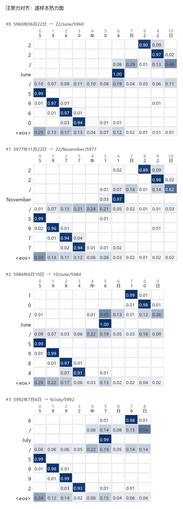

# 从零手写带注意力机制的序列翻译模型（纯 NumPy）

一个用于**巩固注意力机制**的练习项目。不依赖 PyTorch / TensorFlow，
注意力机制、GRU、反向传播全部手写，用梯度检验保证正确性。

```
任务：中文日期 → 英文日期
      2008年11月11日   →   11/November/2008
      2037年03月09日   →   9/March/2037        （2037 年训练时从未出现）
```

---

## 为什么不用框架

直接用 `nn.MultiheadAttention` 当然更快，但你会跳过最关键的几步：
score 怎么算、softmax 之前为什么要加 mask、梯度怎么流过注意力权重、
以及**为什么加了注意力就比固定 context 向量好**。
这些恰好是这个练习要回答的问题。

---

## 路线图

| 步骤 | 内容 | 状态 |
|---|---|---|
| **1** | 项目骨架 + 数据管道（语料 / 词表 / padding / batch / mask） | ✅ 已完成（54 断言） |
| **2** | 注意力模块：加性 Bahdanau + 缩放点积，前向 + 反向 + 梯度检验 | ✅ 已完成（70 断言） |
| **3** | 基础层（Linear / Embedding）+ 编码器 GRU 前向 + BPTT 反向 | ✅ 已完成（84 断言） |
| **4** | 带注意力的解码器：前向 + 反向，teacher forcing，因果性 | ✅ 已完成（74 断言） |
| **5** | 交叉熵 + Adam + warmup/余弦退火 + 训练循环 + 贪心解码 | ✅ 已完成（100 断言） |
| **6** | Beam Search + 暴力枚举验证 + 与贪心的对比 | ✅ 已完成（76 断言） |
| **7** | 注意力对齐热力图 + 理想对齐命中率分析 | ✅ 已完成（103 断言） |
| **8** | 消融实验：无注意力基线 / 注意力类型 / 输出层输入 / 初始状态 | ✅ 已完成（54 断言） |

---

## 训练结果（3000 步，206 秒）

```
                          中文日期 → 英文日期
  源句  5960年06月22日   →   目标  22/June/5960      （5960 训练时从未出现）

数据集      TF loss   TF token    TF seq   AR token    AR seq
train       0.0002     1.0000    1.0000     1.0000    1.0000
dev         0.0008     1.0000    1.0000     1.0000    1.0000
test        0.0002     1.0000    1.0000     1.0000    1.0000

背诵检测：生成的年份落在训练年份集合中的比例 = 0.00%
          → 模型真的在「照抄数字」，而不是背训练年份
```

模型 257,435 参数，纯 NumPy，CPU 上 68.9 ms/step。

```powershell
python scripts/05_train.py            # 完整训练（约 3.5 分钟）
python scripts/05_train.py --quick    # 400 步快速版
```

---

## 目录结构

```
seq2seq_attn/          模型与数据代码
    config.py          全部超参数（dataclass，便于做消融）
    data.py            语料生成 / 分词 / 词表 / padding / batch        ★第 1 步
    nn.py              参数容器 / softmax / log_softmax / Linear / Embedding / 梯度检验  ★第 2、3 步
    attention.py       加性注意力 + 缩放点积注意力（前向 + 反向）      ★第 2 步
    encoder.py         GRUCell + GRUEncoder（含 BPTT 反向）            ★第 3 步
    decoder.py         AttentionDecoder（Bahdanau 式，前向 + 反向）    ★第 4 步
    losses.py          CrossEntropyLoss（log_softmax + padding mask）  ★第 5 步
    optim.py           Adam / 全局范数裁剪 / warmup+余弦退火            ★第 5 步
    model.py           Seq2Seq 组装 + 贪心解码                          ★第 5 步
    train.py           训练循环 / 评估 / 健全性检查                     ★第 5 步
    infer.py           Beam Search + 暴力枚举参照                       ★第 6 步
    viz.py             注意力对齐可视化 + 理想对齐分析                   ★第 7 步
scripts/               每步一个可运行的自检脚本
    01_data_pipeline.py
    02_attention.py
    03_encoder.py
    04_decoder.py
    05_train.py
    06_infer.py
    07_visualize.py
    08_ablation.py
tests/                 无框架依赖的断言测试（当前 615 项）
    test_data.py         54 项
    test_attention.py    70 项
    test_encoder.py      84 项
    test_decoder.py      74 项
    test_losses_optim.py 100 项
    test_infer.py        76 项
    test_viz.py          103 项
    test_ablation.py     54 项
checkpoints/           训练好的权重（steps3000.npz，1.88 MB）
viz/                   注意力热力图 PNG
ablation/              消融实验结果（JSON，可并行跑分片）
notes/                 中文学习笔记，每步一份
    01-数据管道.md
    02-注意力机制.md
    03-编码器GRU.md
    04-解码器与注意力.md
    05-交叉熵与训练.md
    06-BeamSearch.md
    07-注意力对齐可视化.md
    08-消融实验.md
```

---

## 环境

只需 Python 3.8+ 和 NumPy。本项目在 **Python 3.12.14 + NumPy 2.3.5** 下开发。

```powershell
# 每步一个自检脚本
python scripts/01_data_pipeline.py
python scripts/02_attention.py
python scripts/03_encoder.py
python scripts/04_decoder.py
python scripts/05_train.py            # 完整训练，约 3.5 分钟
python scripts/06_infer.py            # Beam Search 验证与对比，约 2 分钟
python scripts/07_visualize.py        # 注意力对齐热力图 + 定量分析
python scripts/08_ablation.py --all   # 消融实验（12 个训练任务，约 5 分钟/6 并行）

# 运行全部测试（当前 615 项断言）
python tests/test_data.py
python tests/test_attention.py
python tests/test_encoder.py
python tests/test_decoder.py
python tests/test_losses_optim.py
python tests/test_infer.py
python tests/test_viz.py
python tests/test_ablation.py
```

Windows 控制台若出现中文乱码，脚本内部已强制 UTF-8 输出；
如仍有问题可先执行 `chcp 65001`。

---

## 关键设计决定（备忘）

1. **数字逐位切分**：词表只 17/27 个符号，训练几分钟收敛；
   且能用**没见过的年份**做测试，验证组合泛化而不是死记硬背。
2. **不用 `<unk>` 兜底**：词表 100% 覆盖，注意力可以专注在结构上。
3. **mask 用 `-inf` + `isfinite` 保护**（而不是加 `-1e9`）：
   两者在正常量级下**逐位相同**，选前者的理由是整行全 mask 时语义明确
   （返回全 0，而不是静默退化成 `softmax(scores)`）。
4. **加性 mask 在 softmax 之前加**：softmax 之后再乘会破坏归一化。
5. **mask 形状必须显式插轴成 `(B,1,S)`**：numpy 广播从右对齐，
   `(B,S)` 配 `(B,Tq,S)` 在 `Tq=1` 时会**静默**错位 —— 而这正是解码器的真实配置。
6. **全程 float64**：数值梯度检验需要它。
7. **梯度检验统一用 ε = 1e-5**：中心差分的最优 ε ≈ `ε_mach^(1/3) ≈ 6e-6`。
8. **词表只从训练集构建**，数据划分按年份、日期不重复。
9. **每个模块先独立验证再拼接**：注意力和编码器都自带梯度检验，
   第 4 步拼接时它们已是可信零件。
10. **GRU 采用 PyTorch 约定**（`h' = (1-z)⊙n + z⊙h`），
    三个门拼成一个 `(in, 3H)` 矩阵一次算完。
11. **`Embedding` 反向必须用 `np.add.at`**：numpy 花式索引是拷贝语义，
    重复 token（如日期里的 `'1'` 出现 4 次）会丢梯度。
12. **循环网络必须逐步 `save_cache` / `load_cache`**：
    `Module._cache` 只有一个槽位，BPTT 时不恢复中间量会让梯度完全错
    （实测相对误差 1.0，但**形状全对、不报错**）。
13. **padding 位置的状态必须冻结**：否则 `h_final` 随 padding 数量漂移，
    同一句话在不同 batch 里编码结果不同。
14. **`backward` 一律累加、不清零**，调用方负责 `zero_grad()`（PyTorch 约定）。
15. **循环里被调用多次的模块都要 `save_cache`**：解码器里有三个（`attn` / `cell` / `out`）。
16. **反向传播里的汇合点必须相加**：`context` 用在两处、`s_t` 用在两处、
    `dkeys + dvalues` 来自同一份 `H_seq`。
17. **梯度检验用自校准判据**：`|解析-数值| ≤ 10·(|数值(ε)-数值(4ε)| + 1e-6·|解析|)`。
    单一阈值在「梯度比 loss 小 8 个数量级」时会误报（实测 `attn.W_q`）。
18. **数据划分必须防止「背诵」**（第 5 步用实测纠正的设计缺陷）：
    ① 每个数位上出现过的数字，训练集都要覆盖；
    ② `样本数 / 不同年份数` 要接近 1。
    最初 `train=(2000,2029)` + 4000 样本 = 133 次/年，模型直接背下 30 个年份，
    测试集整句准确率 0%；改成 `train=(1000,5799)` 后（1.47 次/年）变成 100%。
19. **`log_softmax` 必须和 softmax 融合算**，`log(softmax(x))` 会下溢成 `-inf`。
20. **梯度裁剪用全局范数**（保持方向），且范数要在裁剪**之前**记录。
21. **Beam Search 不能因为「已完成假设攒够 beam_size 条」就提前停止**。
    `done` 里够数不代表存活 beam 里没有更好的候选 —— 实测会让
    100% 的模型掉到 60%。正确做法：跑到 `max_len`，最后从
    「已完成 ∪ 仍存活」里一起挑。
22. **Beam Search 优化的是模型分数，不是准确率**。实测三种结果都出现过：
    模型很准时与贪心完全相同、模型不够准时 Beam 有收益、
    模型分数失准时 Beam **反而更差**。
23. **评价指标的定义错误，看起来和模型错误一模一样**（第 7 步）：
    理想对齐漏写了 `月` 定界符，于是把「只在 10 月关注定界符」这个
    **完全正确**的行为误判成 10% 失败率。
    看到失败率先问一句「失败的样本有什么共同点」。

---

## 注意力对齐做到了什么（第 7 步的结果）

```
测试集 400 条，2676 个对齐点：
  argmax 命中率       1.0000    （注意力最大的源位置落在理想集合里）
  年份严格位置精确率   1.0000    （输出第 k 位正好看源句的第 k 位）
  字段之间递减        1.0000    （日是源句末尾、年是源句开头，方向相反）
  字段内部递增        1.0000    （照抄顺序一致）

年份跨度矩阵（4×4）对角线均值 = 0.9822    ← 逐位对齐，不是"大致看这一片"

归一化熵：日的数字 0.082 / 年份 0.067 / 月份 0.053   ← 很集中
          分隔符 '/' 0.734 / 终止符 <eos> 0.855      ← 散开（本来就不需要看）
```



---

## 消融实验（第 8 步）：注意力到底带来了多少

训练集 500 条（数据受限）与 4000 条（数据充足）两套，各配置只改一个变量、训练 1500 步：

| 配置 | 参数量 | 注意力参数 | 收敛步数 | **test AR 整句（500 / 4000）** |
|---|---|---|---|---|
| baseline（加性注意力） | 257,435 | 33,024 | 750 / 600 | **0.9950 / 1.0000** |
| **去掉注意力**（固定 context 向量） | 224,411 | 0 | — | **0.1425 / 0.5975** |
| 缩放点积（零参数） | 224,411 | **0** | **450** | **1.0000 / 1.0000** |
| 输出层只吃 `s_t` | 253,979 | 33,024 | — | **0.5850 / 0.9325** |
| 输出层吃 `[s_t;c_t;emb]` | 259,163 | 33,024 | 900 / 450 | 0.9850 / 1.0000 |
| 初始状态恒为零 | 257,435 | 33,024 | **300 / 450** | 1.0000 / 1.0000 |

四个结论：

1. **注意力是必需的**：去掉后 `99.50% → 14.25%`（数据受限）、
   `100% → 59.75%`（数据充足）。数据翻 8 倍也补不回来 —— 瓶颈是**结构**不是数据量。
2. **机制比算法细节重要**：零参数的点积注意力拿到 100%，收敛还快 1.67 倍。
   33k 个注意力参数换来的不是效果。
3. **context 直接进输出层很重要，但数据能部分补偿**：
   `-41 个百分点`（500 条）→ `-6.75 个百分点`（4000 条）。
4. **桥接投影 `s₀ = tanh(W·h_final)` 完全冗余**：置零后仍是 100%，收敛还更快。

> 完整分析见 [第 8 步笔记](notes/08-消融实验.md)。

---

## 学习笔记

- [第 1 步 · 数据管道](notes/01-数据管道.md)
- [第 2 步 · 注意力机制](notes/02-注意力机制.md)
- [第 3 步 · 编码器 GRU](notes/03-编码器GRU.md)
- [第 4 步 · 解码器与注意力](notes/04-解码器与注意力.md)
- [第 5 步 · 交叉熵与训练](notes/05-交叉熵与训练.md)
- [第 6 步 · Beam Search](notes/06-BeamSearch.md)
- [第 7 步 · 注意力对齐可视化](notes/07-注意力对齐可视化.md)
- [第 8 步 · 消融实验](notes/08-消融实验.md)
